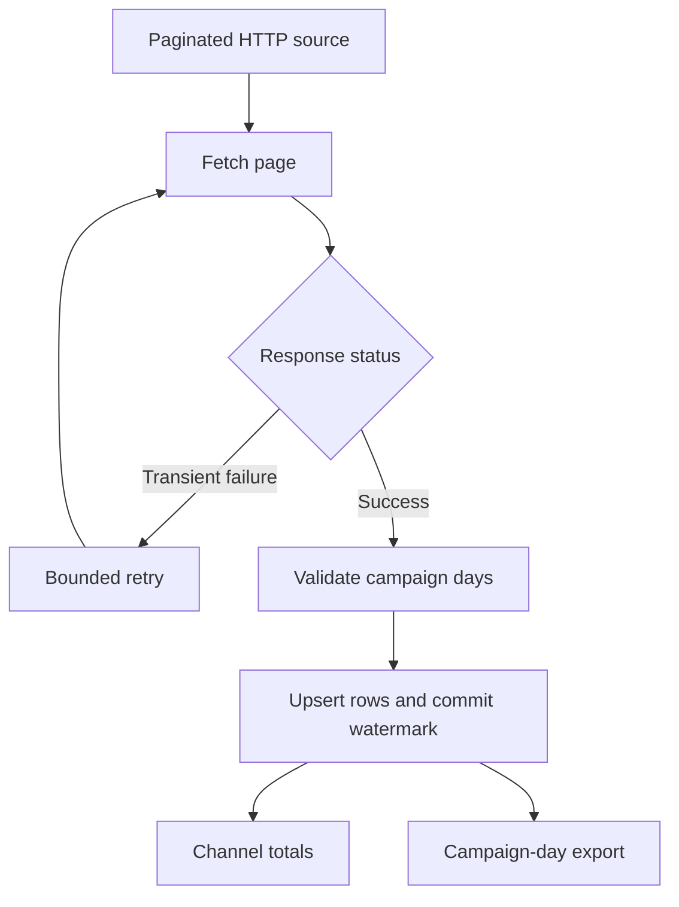

# Marketing analytics portfolio · Projects 1–5

Clone or download this repository and open **index.html** in a browser. Each report opens offline and links to its source tables. The four examples use separate synthetic datasets, so totals and populations are specific to each case. [Project 1](fieldline-dashboard.html) is an interactive $2 million B2B cross-channel dashboard with client, quarter and channel filters.

## Project files

| Folder | Business decision | Technical evidence |
|---|---|---|
| 02-api-pipeline | Can daily paid-media reporting tolerate retries and corrections? | Local HTTP API, pagination, incremental cursor, transactional SQL upserts, SQLite and PostgreSQL execution logs, channel export and a 20-second walkthrough |
| 03-attribution | How sensitive is a channel budget decision to the attribution model? | Ordered touches, SQL window functions, reconciled first-touch, last-touch and linear credit, CAC, gross-profit ROI and a three-case sensitivity analysis |
| 04-retention | Which customers justify a retention experiment? | Order-level data, cohort heatmap, customer-level RFM scores, margin-based value forecast and a time-based backtest |
| 05-quality-audit | Can channel spend be trusted before reporting? | Source and extract fixtures, SQL checks, ten-rule scorecard, daily reconciliation and a record-level exception queue with owners |

The portfolio cover in each folder is a standalone PNG. Ready-to-paste descriptions are in **upwork-listings.md**. The pipeline video uses silent captioned frames that explain the recorded run.

## Run the examples

Use Python 3.10 or later. From the extracted root, run `python reproduce.py` to generate and verify all four projects in a temporary copy. It checks campaign-day uniqueness and spend, credit reconciliation, cohort bounds, reconciliation exceptions, report links and JSON syntax. The optional GitHub Actions workflow runs this check on push or manual dispatch when the contents are placed at a repository root. No cloud credentials are required for the local demo.

Run the individual scripts to work on an example. The analytics scripts regenerate their own sample inputs and outputs.

```text
python 02-api-pipeline/pipeline.py
python 02-api-pipeline/pipeline.py --revision
python 03-attribution/analyze.py
python 04-retention/analyze.py
python 05-quality-audit/audit.py
python build_reports.py
python build_powerbi.py
```

The included SQLite database already contains the final snapshot. For a clean demonstration use `python reproduce.py`. To run the pipeline on PostgreSQL, install `psycopg[binary]`, set `PORTFOLIO_PG_DSN` to an empty dedicated database, then run the initial and revised snapshots in that order. The local SQLite and PostgreSQL 18 runs each processed 240, 5 and 0 source rows. These runs appear in that order in the included log.

## Pipeline architecture



Source pages remain stable during a run. Credentials, advertising vendor APIs and hosted scheduling are outside the demonstration. The included workflow rebuilds a clean demo on each run.

## Power BI source

Each of Projects 2–5 has a **PowerBI/Fieldline.pbip** entry point, a semantic model and report tables. The Power Query partitions embed result snapshots. Regenerate the Power BI files after changing a CSV and refresh the model in Desktop to load the new values. Results from different attribution models must be compared individually because each model allocates the same cohort total. The JSON files were checked programmatically. Desktop rendering was not tested in the build environment.

## Interpretation

The spend, revenue, forecast and audit findings are fictional. For attribution, separate model sensitivity from incremental impact. For retention, distinguish a finite-horizon contribution estimate from an uncapped lifetime forecast. For the audit, resolve the unpriced row before treating the USD ledger as final.

