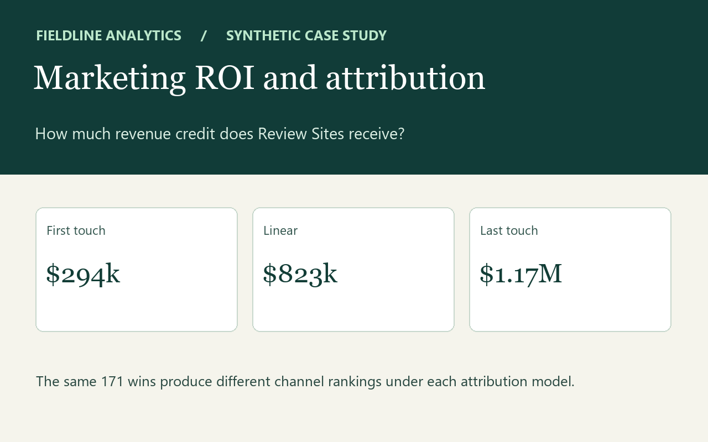

# Marketing analytics portfolio

**Prachi Singh · Marketing analytics developer · [GitHub profile](https://github.com/prachi735)**

Fieldline is the fictional agency in this collection of five synthetic case studies. The dashboard follows a $2 million media budget from spend to pipeline. The other projects examine how those numbers are collected, attributed, forecast and audited.



| Project | Decision | Evidence to inspect |
|---|---|---|
| [01 · Cross-channel dashboard](01-dashboard/index.html) | Which campaigns warrant a budget review? | Filter by client, quarter and channel. Compare monthly qualified leads with their target markers. |
| [02 · Marketing API pipeline](02-api-pipeline) | Can the agency replay late corrections safely? | Inspect the five updates and the zero-row replay in the execution log. |
| [03 · Attribution and ROI](03-attribution) | Does the budget recommendation depend on the credit model? | Compare three allocations of the same 171 wins and examine a $10,000 reallocation scenario. |
| [04 · Retention and customer value](04-retention) | How much contribution should the retailer budget for existing buyers? | Inspect the cohort heatmap and compare aggregate forecast error with individual error. |
| [05 · Data quality audit](05-quality-audit) | Which discrepancies block spend sign-off? | Trace 13 findings to source records and reconcile daily spend across three currencies. |

## Open the portfolio

Clone the repository and open `index.html` in a browser. Each report uses local files. The agency, customers, spend and business outcomes are illustrative. Each project has its own dataset.

## Reproduce the results

From the repository root, run the following with Python 3.12 and Node.js 22.

```sh
python reproduce.py
python -m unittest discover -s tests -v
```

The rebuild uses a temporary directory, verifies 150 dashboard filter combinations, regenerates the four Python analyses and checks report links. The regression tests exercise the upsert, network retry and currency mismatch rules. GitHub Actions runs the same regression tests with pytest.

### Pipeline evidence

The [SQLite log](02-api-pipeline/results/execution.log) identifies the engine and version for each run. The [CI workflow](.github/workflows/portfolio.yml) starts a fresh PostgreSQL 18 service, checks the 240 / 5 / 0 load sequence and reconciles final spend. Its `postgresql-replay` artifact contains the versioned server log.

To reproduce against your own empty PostgreSQL database, install `psycopg[binary]`, set `PORTFOLIO_PG_DSN`, then run `python 02-api-pipeline/pipeline.py` once and `python 02-api-pipeline/pipeline.py --revision` twice. A single transaction commits the campaign-day corrections and watermark.

### Optional Power BI table exports

Projects 02–05 include generated PBIP snapshots containing plain tables for importing the results into Power BI. The browser reports contain the portfolio visualizations. Desktop rendering of the optional exports is unverified.
